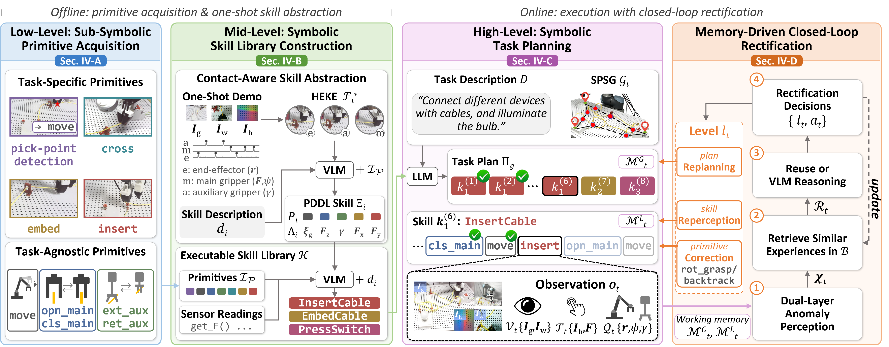

# HIE-Plan-Cable-Assembly
## __HIE-Plan: Hierarchical and Interaction-Aware Embodied Planning for Long-Horizon Cable Assembly__

💡 We are working on hierarchical and interaction-aware embodied planning (HIE-Plan) for long-horizon, contact-rich robotic cable assembly. The paper has been submitted to _IEEE/ASME Transactions on Mechatronics_, and the code will be released upon acceptance.

## 🎥 __The vedio of extensive robotic experiments could be found at [here](https://youtu.be/UIX6jxIGCQo)🔗:__

## Paper abstract
Robotic cable assembly is a typical long-horizon, contact-rich manipulation task in electrical manufacturing. Hierarchical planning, which decomposes such tasks into subgoals achieved by reusable manipulation skills, is widely adopted owing to its data efficiency and interpretability. However, reliable cable assembly remains challenging, since cable--environment contacts are often occluded from vision, and minor anomalies readily cascade over long horizons. To address these issues, we propose a Hierarchical and Interaction-aware Embodied Planning (HIE-Plan) framework, which spans primitive acquisition, skill construction, task planning, and closed-loop rectification. Specifically, an expert-free skill construction mechanism is developed, in which a vision-language model builds each skill from a one-shot demonstration, with its switching conditions grounded in tactile and proprioceptive signals. A semantic-progress scene graph is then designed to encode entity relations and execution progress for large language model-based planning and monitoring. Furthermore, memory-driven closed-loop rectification is introduced, integrating dual-layer anomaly perception with evolving context-aware episodic memory for reliability-aware hierarchical recovery, improving execution efficiency and robustness. Real-world lighting-circuit assembly experiments, each involving over 50 interdependent primitives, show that HIE-Plan outperforms representative methods, raising the task success rate by 30 percentage points in both seen and unseen scenarios and the recovery success rate by 60 percentage points on average.
